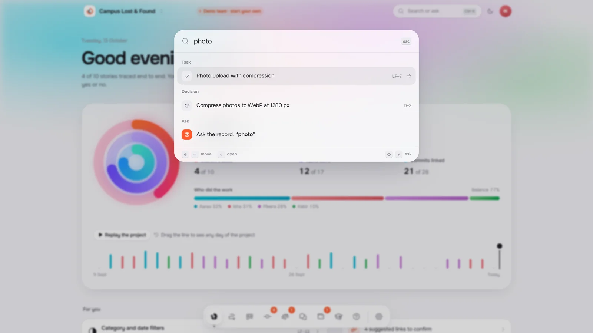

<picture>
  <source media="(prefers-color-scheme: dark)" srcset=".github/media/banner-dark.webp">
  
</picture>

  <b>Trace</b> is the workspace student software teams use to show who built what, why it was decided, and what is left.
    
  <a href="https://tracethis.vercel.app"><b>Open Trace</b></a>
  &nbsp;·&nbsp;
  <a href="https://tracethis.vercel.app/enter">Look around a demo team</a>
  &nbsp;·&nbsp;
  <a href="#for-mentors">For mentors</a>

 

Group projects tend to end the same way. Someone asks who wrote the search, why the team switched to email alerts, or whether the login story is really finished, and nobody can quite say. The commits are in one place, the decisions are in a chat, the tasks are on a board, and the requirements are in a document that stopped being true weeks ago.

We built Trace so that never happens. Every requirement is tied to the tasks behind it, the commits that delivered it, the decisions that shaped it and the people who did the work, and it stays that way as the project moves.

 

## A project you can see

Three rings say how done a team really is: stories traced from requirement to working code, tasks finished, and commits tied to a story. Drag back along the timeline and every number, ring and share of the work is rebuilt for that day. Press play and the whole project rebuilds itself from the first commit.

Each workspace is lit in its team's colours. Every member is a pool of light sized by their share of the work, so a balanced team glows evenly and a team carried by one person shows it at a glance.

 

## Every requirement, traced

Each story carries its chain of evidence: the tasks behind it, every commit in the colour of whoever made it, the decisions that shaped it and the people who built it. A commit that mentions `LF-12` links itself. For everything else, Trace suggests the match and a teammate says yes or no, and a rejected suggestion never comes back.

The whole traceability matrix exports in one click, ready for a report.

 

## Receipts, not opinions

Every teammate gets a receipt, and every line on it is evidence: a commit, a finished task, a decision, a story they wrote. Shares come from the record, not from anyone's opinion, and no line is written by AI.

Anyone can dispute a line and say what really happened. The team lead resolves it, and the receipt keeps both sides. It prints cleanly, for the day someone needs it on paper.

 

## Ready for the viva

Flashcards on the code, decisions and requirements a student did *not* work on, answered from the team's own record. Say the answer out loud, flip the card, be honest about how it went. Practice only: nothing is graded or shown to anyone.

 

## Ask the record

One shortcut opens a search across every story, task, decision and person. Type a question instead, like *why did we email match alerts instead of push?*, and Trace answers from the team's own decisions, chat and commits, with every claim pointing at its source.

 

## For mentors

A mentor sees every team they guide on one page, the teams that need attention first: how much is traced, who is carrying the work, who went quiet, open disputes and decisions that contradict each other.

Getting there takes a few seconds. A team lead reads out the team's mentor code, or adds the mentor by email before they even have an account, and the team appears the moment they sign in. Mentors can read everything, comment and raise disputes, but the record stays the team's.

 

## In every pocket

Trace works the same on a phone, in light or dark, with the team's chat, its board and its receipts a thumb away.

 

## How it fits together

1. **Write the stories.** Each one says who it is for, what they need and why, with acceptance criteria anyone can demo. Stories and tasks share one counter, so every item has a short ID like `LF-12`.
2. **Do the work.** Tasks move across the board. Commits that name an item link themselves; Trace suggests the rest.
3. **Decide out loud.** Start a chat message with `/decide` and it becomes a numbered decision, with its reasons, tied to the conversation it came from.
4. **Close the rings.** A story is *traced* when every task is done and at least one commit stands behind it. When all three rings close, the project is done, and the team can prove it.

 

  <a href="https://tracethis.vercel.app"><b>tracethis.vercel.app</b></a>
    
  Designed and built by <a href="https://github.com/sirgreaseball">Dhruv Sonar</a>. © 2026. All rights reserved.

