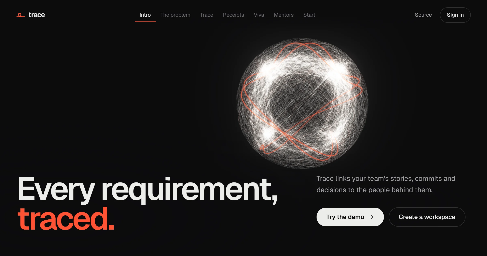
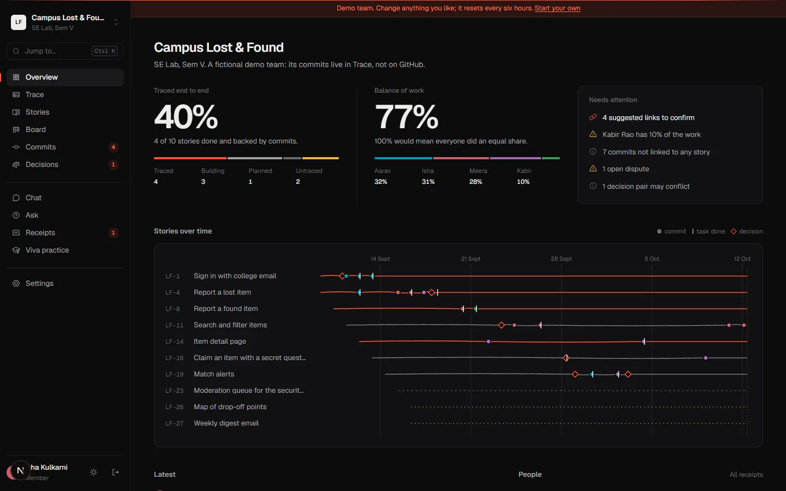
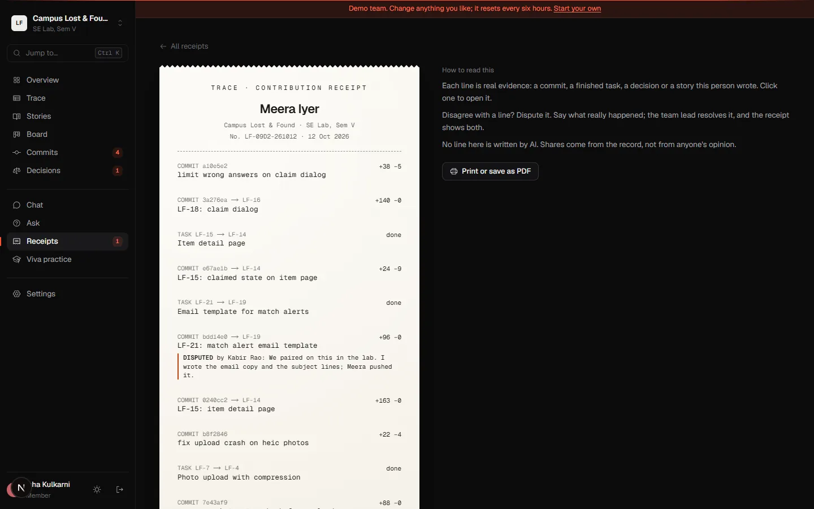
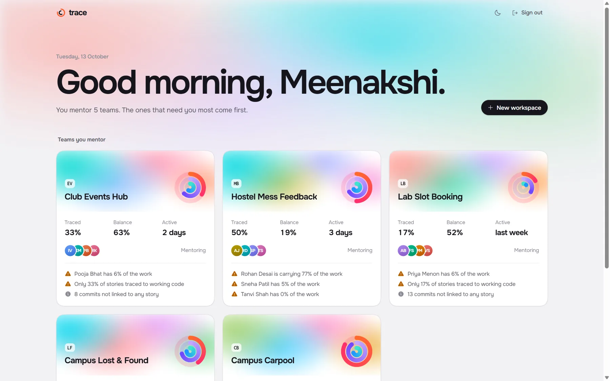

<p align="center">
  
</p>

# Trace

**Every requirement, traced.** Trace is a workspace for student software teams. It links each story to the tasks, commits and decisions behind it, and to the people who did the work, so a team (and its mentor) can always answer three questions: *who built this, why was it done this way, and what is left?*

**Live:** [tracethis.vercel.app](https://tracethis.vercel.app). Press **Try the demo** to look around a fictional team, or **See the mentor demo** for the view across five teams.

## What it does

| | |
| --- | --- |
| **Trace grid** | A live requirements traceability matrix. Every story shows its tasks, linked commits, decisions and people, and whether it is untraced, planned, building or traced. Export it as CSV. |
| **Commit linking** | A commit that names an item (`LF-12: add photo upload`) links itself. For the rest, Trace suggests a match from the words in the message and the files it touched; a teammate confirms or rejects it. |
| **Receipts** | One receipt per person, printed like a thermal receipt. Every line is evidence you can open: a commit, a finished task, a decision. Anyone can dispute a line; the team lead resolves it and the receipt keeps both sides. No line is written by AI. |
| **Decisions** | A log of the team's choices with the reasons and the alternatives. Type `/decide` in chat to log one. Trace flags pairs of decisions that may contradict each other. |
| **Viva practice** | Questions about the code, decisions and requirements you did *not* work on, answered from the team's own record. Practice only: nothing is graded or shared. |
| **Ask** | Ask "why did we switch to email alerts?" and get the matching decisions, chat messages, stories and commits, best match first. With an AI key set, a short answer that cites them. |
| **Mentor view** | Every team you mentor on one page: how much is traced, how evenly the work is spread, who went quiet, open disputes and conflicting decisions. |

<p align="center">
  
</p>

<p align="center">
  
  
</p>

## How tracing works

Each workspace has a short key, like `LF`. Stories and tasks share one counter, so every item has an ID such as `LF-12`, and decisions are numbered `D-1`, `D-2` and so on.

1. **Sync** pulls the newest commits from a public GitHub repository, with the files and line counts for each.
2. **Link.** Item IDs in commit messages create confirmed links. Commits without an ID get at most one suggested link, scored by the words they share with a task or story. Rejected suggestions are never suggested again.
3. **Trace.** A story is *traced* when all its tasks are done and at least one commit is confirmed against it.
4. **Receipts and balance.** A member's share weighs commits (40%), changed lines (30%, capped per commit so a lockfile can't dominate) and finished tasks (30%). Balance is one minus the Gini coefficient of those shares.

All of this lives in one pure module, [`src/lib/trace.ts`](src/lib/trace.ts), shared by the server, the browser and the demo seeder, so every number on screen has exactly one definition. It has its own tests (`npm test`).

## Stack

- **Next.js 16** (App Router, React 19, TypeScript) and **Tailwind CSS 4**.
- **Supabase**: Postgres with row-level security on every table, auth, realtime chat and full-text search (`search_evidence`).
- **three.js** for the landing page: a few hundred threads drawn as screen-space ribbons, positioned entirely on the GPU, morphing through seven formations as you scroll, with bloom and supersampling. **Lenis** for smooth scrolling.
- Optional AI through free tiers (Groq, then Gemini, then OpenRouter) behind one OpenAI-compatible call. Every AI feature has a plain fallback, so the app works with no keys at all.

### Security model

The browser talks to Postgres directly, so access is enforced in the database, not the UI:

- Members read their workspace; owners and members write; mentors read and can raise disputes but cannot change the record.
- Cross-table references are checked to stay inside one workspace, workspace IDs are immutable, and a workspace always keeps at least one team lead.
- Workspace creation, invites and search run through narrowly scoped database functions.

## Run it locally

```bash
npm install
cp .env.example .env.local   # then fill in your Supabase URL and publishable key
npm run dev
```

Set up the database by running the files in [`supabase/migrations`](supabase/migrations) in order in the Supabase SQL editor. `0002_demo.sql` creates the demo teams; regenerate it with `npm run seed`.

| Variable | Needed for |
| --- | --- |
| `NEXT_PUBLIC_SUPABASE_URL`, `NEXT_PUBLIC_SUPABASE_PUBLISHABLE_KEY` | Everything |
| `DEMO_PASSWORD` | The demo buttons (set the same password on the two demo accounts) |
| `GROQ_API_KEY`, `GEMINI_API_KEY`, `OPENROUTER_API_KEY` | Optional AI answers, linking and viva follow-ups |
| `GITHUB_TOKEN` | Optional; raises GitHub sync limits from 60 to 5,000 requests an hour |

In Supabase, turn off **Authentication > Sign In / Providers > Email > Confirm email** (or connect your own SMTP server) so new accounts can sign in straight away.

## Project layout

```
src/app            routes: landing, sign-in, workspace pages, API routes
src/components     UI, the thread engine (splash/engine.ts) and the landing page
src/lib            the trace engine, data loading, AI and GitHub helpers
supabase           schema, policies and demo data
scripts            demo data generator
```

---

Made by [Dhruv Sonar](https://github.com/sirgreaseball). All rights reserved.
