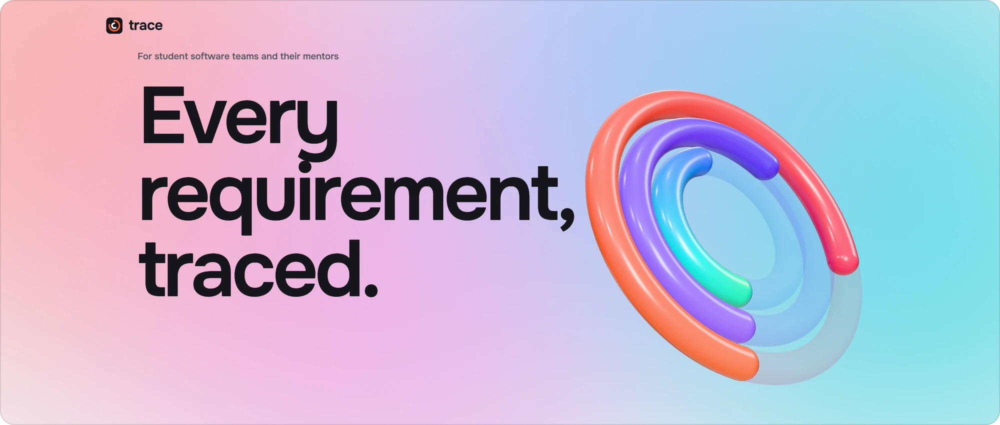
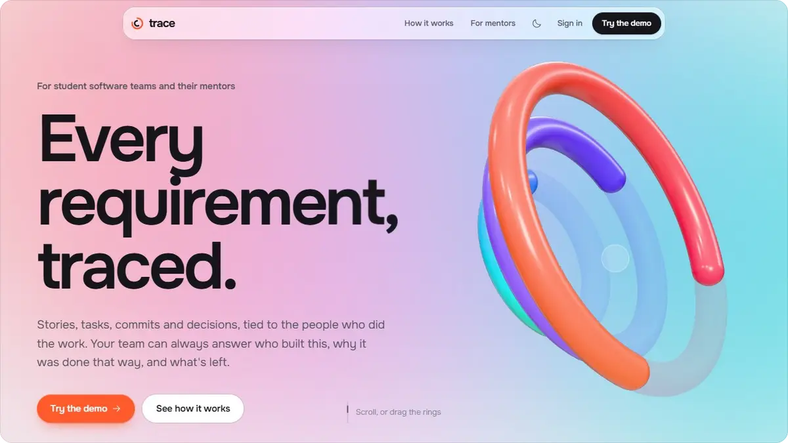
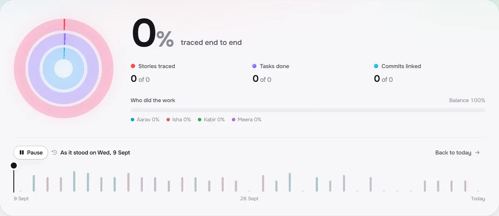
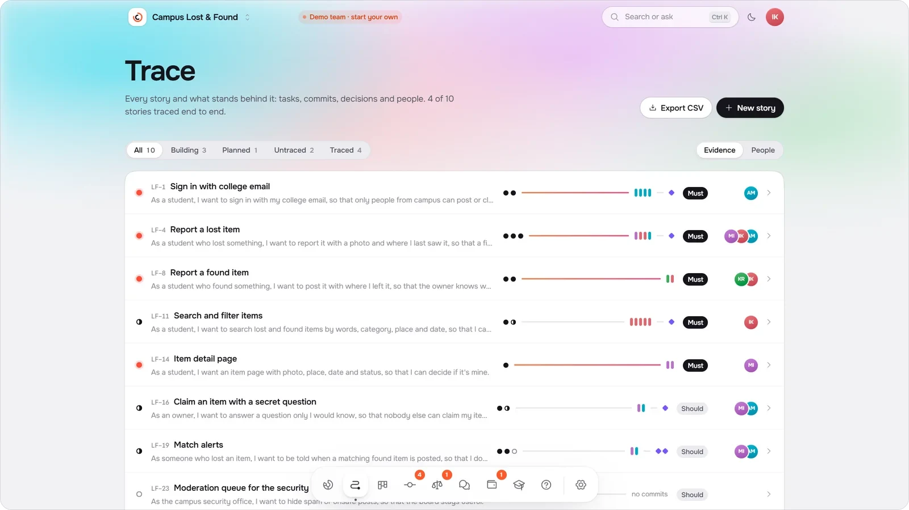
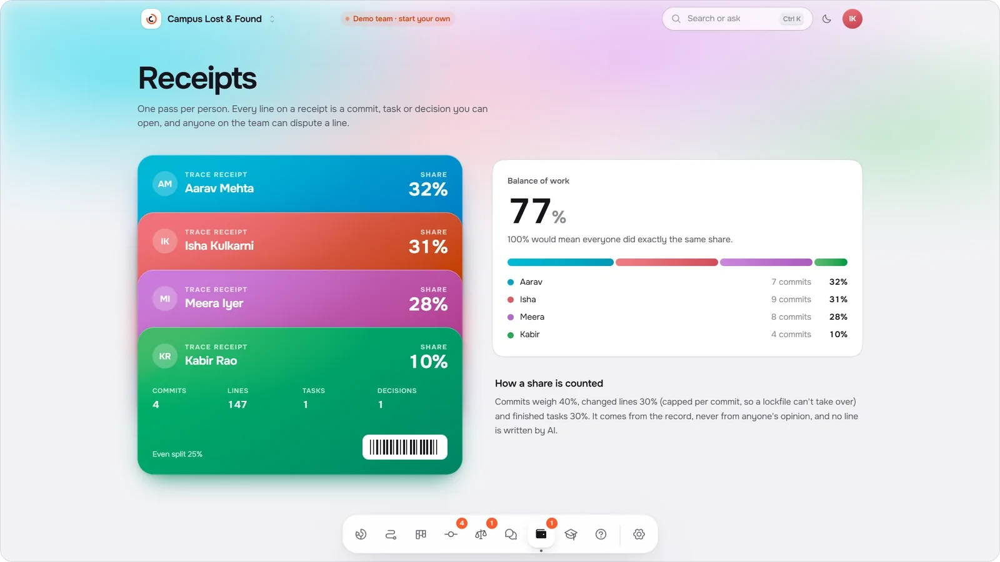
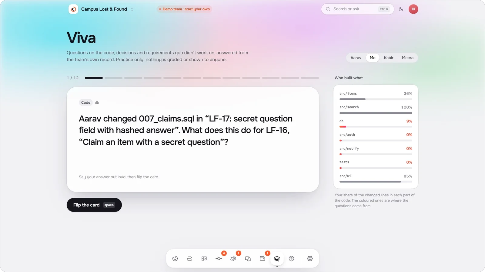
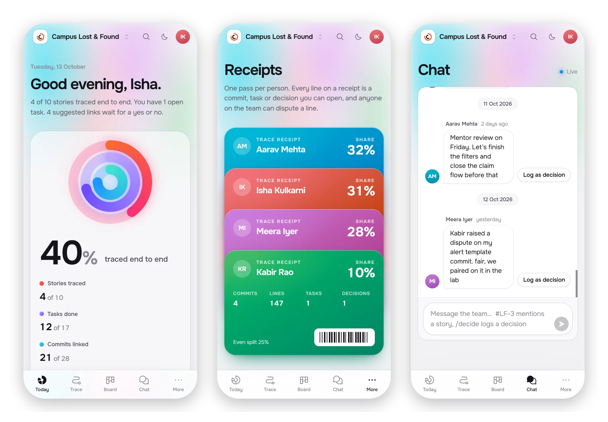

<a href="https://tracethis.vercel.app">
  <picture>
    <source media="(prefers-color-scheme: dark)" srcset=".github/media/banner-dark.webp">
    
  </picture>
</a>

 

  <b>Trace</b> is where student software teams keep the receipts. 
  Every requirement is tied to the tasks, commits, decisions and people behind it, 
  so a team can show who built what, why it was decided, and what is left.

  

  For student software teams&ensp;·&ensp;and the mentors who guide them

 

<picture>
  <source media="(prefers-color-scheme: dark)" srcset=".github/media/film-dark.webp">
  
</picture>

 
 

### A project you can see.

Three rings say how done a team really is: stories traced from requirement to working code, tasks finished, commits tied to a story. Drag back along the timeline and every ring, number and share of the work is rebuilt for that day.

 
 

### Every requirement, traced.

Each story carries its chain of evidence: the tasks behind it, every commit in the colour of whoever made it, and the decisions that shaped it. A commit that names a story links itself. The whole traceability matrix exports in one click.

 
 

### Receipts, not opinions.

Every teammate gets a receipt, and every line on it is evidence. Shares come from the record, not from anyone's opinion. Anyone can dispute a line, and the receipt keeps both sides.

 
 

### Ready for the viva.

Flashcards on the code and decisions a student did *not* work on, drawn from the team's own record. Practice only: nothing is graded or shown to anyone.

 
 

### Every team, at a glance.

A mentor sees every team they guide on one page, the ones that need attention first: how much is traced, who is carrying the work, who went quiet, and which decisions contradict each other.

 
 

### In every pocket.

 
 

  
    
  Next.js, Supabase and Three.js.
   
  Designed and built by Dhruv Sonar. © 2026. All rights reserved.

